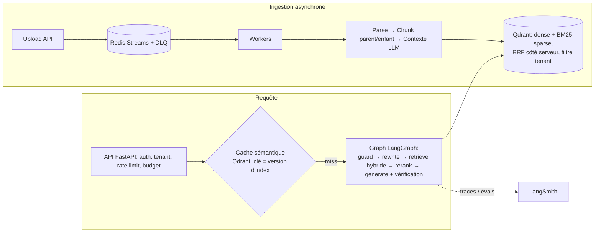

# open-rag — RAG de production (LangChain · LangGraph · LangSmith)

Projet de référence **pédagogique** : chaque module répond à « que faut-il savoir pour mettre un RAG en production ? ». Lisez les docstrings (`WHY:`) et la fiche [docs/concepts.md](docs/concepts.md), qui relie chaque concept au fichier correspondant.

## Démarrage en 2 minutes (100 % offline, sans clé API)

```bash
python -m venv .venv && . .venv/bin/activate      # Windows : .venv\Scripts\activate
pip install -e ".[dev]"
cp .env.example .env
pytest -q                                          # 30 tests (RAG_TEST_QDRANT_URL=… : contre un vrai serveur Qdrant)
python -m evals.run_eval                           # ablation retrieval + e2e + métriques
python -m open_rag.cli ingest data/corpus
python -m open_rag.cli ask "What does error NB-4021 mean?"
uvicorn open_rag.api:app --reload                  # API sur :8000, docs OpenAPI sur /docs
```

Le mode `fake` (par défaut) utilise des embeddings déterministes et un générateur extractif : il permet de tester toute la plomberie (ingestion, hybrid, graph, garde-fous, cache, API) sans réseau. **Pour une vraie qualité** : `RAG_LLM_PROVIDER=openai`, `RAG_EMBEDDING_PROVIDER=openai`, `OPENAI_API_KEY=...`.

Stack complète (API + worker + Qdrant + Redis) : `make up` (Docker requis).
Tracing / évaluation LangSmith : renseigner `LANGSMITH_TRACING=true`, `LANGSMITH_API_KEY`, puis `python -m evals.run_eval --langsmith`.

## Architecture en une image



## Carte du code

| Chemin | Rôle | Concept |
|---|---|---|
| `src/open_rag/ingestion/` | loaders, chunking, pipeline | parsing, chunking structuré parent-enfant, contextual retrieval |
| `src/open_rag/indexing/` | Qdrant, alias, reindex | multi-tenant, blue/green, idempotence |
| `src/open_rag/retrieval/` | sparse, hybrid RRF, rerank | recherche hybride, reranking |
| `src/open_rag/generation/` | prompts, chains, guardrails | sortie structurée, citations, sécurité |
| `src/open_rag/graph.py` | pipeline LangGraph | orchestration explicite et traçable |
| `src/open_rag/service.py`, `cache.py` | composition, cache sémantique | coût/latence, invalidation |
| `src/open_rag/api.py`, `queue.py` | HTTP, SSE, ingestion async | scalabilité, observabilité |
| `evals/` | dataset d'or, métriques, LangSmith, gate CI | évaluation continue |
| `deploy/` | Dockerfile, compose, k8s (HPA, KEDA, PDB) | déploiement à grande échelle |
| `docs/` | architecture, ADR, évaluation, scalabilité, sécurité, runbook | documentation |

## Documentation

- [Architecture](docs/architecture.md) · [Concepts à retenir](docs/concepts.md) · [Évaluation](docs/evaluation.md)
- [Scalabilité](docs/scalability.md) · [Sécurité](docs/security.md) · [Runbook](docs/runbook.md)
- ADR : [stack](docs/adr/0001-stack.md) · [chunking](docs/adr/0002-chunking.md) · [hybrid](docs/adr/0003-hybrid-retrieval.md) · [queue](docs/adr/0004-ingestion-queue.md)

## Limites assumées (voir aussi docs/scalability.md)
- Pipeline synchrone (thread pool borné par `RAG_API_THREADS`) : la montée en charge passe par les réplicas ; un passage en async de bout en bout augmenterait la concurrence par pod.
- La file Redis Streams est testée avec `fakeredis` ; Qdrant est testé en embarqué **et** contre un serveur 1.19.
- Parsing léger (md/html/pdf texte) : brancher Docling/Unstructured pour PDF complexes.
- Corpus de démonstration minuscule (13 chunks) : il valide la plomberie, **pas** les gains relatifs hybrid/rerank — il faut un corpus réel (voir docs/evaluation.md).
