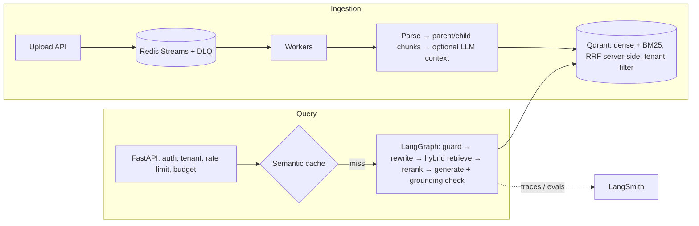

<div align="center">

# open-rag

**Production-ready RAG (Retrieval-Augmented Generation) you can deploy in minutes.**

Hybrid search (BM25 + vectors) · LLM reranking · cited, guarded answers · multi-tenant FastAPI + Qdrant · LangGraph pipeline · LangSmith evals · benchmarked on Open RAG Bench.

[](https://github.com/w4coder/open-rag/actions/workflows/ci.yml)
[](LICENSE)


[Quickstart](#quickstart) · [Benchmark](#benchmark-open-rag-bench) · [Architecture](#architecture) · [Deploy](#deploy-to-production) · [Docs](docs/architecture.md) · [Français](README.fr.md)

</div>

---

Most RAG tutorials stop at "embed, search, prompt". **open-rag** is a turnkey RAG backend that covers what comes next: ingesting real documents, finding the right passage among thousands of look-alikes, refusing when the answer is not there, citing every claim, serving many tenants, and **measuring quality** before every release.

Upload your documents, call one HTTP endpoint, get an answer with its sources.

```bash
curl -X POST localhost:8000/v1/query -H "X-API-Key: dev-key" \
  -H "Content-Type: application/json" -d '{"question": "What does error NB-4021 mean?"}'
```

```json
{
  "answer": "Error NB-4021 means the API key is expired or revoked.",
  "citations": [{
    "source": "auth.md",
    "section": "Nimbus Platform - Authentication Guide > Error codes",
    "snippet": "Error NB-4021 means the API key is expired or revoked. Error NB-4030 means..."
  }],
  "grounded": true
}
```

## Why open-rag

| | What you get |
|---|---|
| **Accurate retrieval** | Hybrid search: dense vectors + BM25 sparse vectors fused with Reciprocal Rank Fusion inside Qdrant, then an optional LLM or cross-encoder reranker. |
| **Answers you can trust** | Structured output with citations, a grounding guardrail that rejects uncited or fabricated sources, explicit refusals when the documents do not contain the answer, prompt-injection and PII guardrails. |
| **Measured, not guessed** | A golden-set eval in CI and a full harness for [Open RAG Bench](https://huggingface.co/datasets/vectara/open_ragbench) with an LLM judge, confidence intervals and per-question error analysis. |
| **Built for production** | FastAPI with streaming (SSE), API keys per tenant, rate limits and token budgets (Redis), semantic cache, async ingestion queue with dead-letter queue, Prometheus metrics, LangSmith tracing. |
| **Scales out** | Stateless API replicas, blue/green re-indexing with alias swap and rollback, Docker Compose and Kubernetes manifests (HPA, KEDA, PDB). |
| **Runs offline** | A deterministic `fake` provider runs the whole pipeline with no API key: tests, CI and demos work out of the box. |

## Quickstart

Offline, no API key, about two minutes:

```bash
git clone https://github.com/w4coder/open-rag.git && cd open-rag
python -m venv .venv && . .venv/bin/activate        # Windows: .venv\Scripts\activate
pip install -e ".[dev]"
cp .env.example .env
pytest -q                                            # full test suite, offline
python -m open_rag.cli ingest data/corpus
python -m open_rag.cli ask "What does error NB-4021 mean?"
uvicorn open_rag.api:app --reload                    # API on :8000, OpenAPI docs on /docs
```

Real quality with OpenAI models: set these in `.env`.

```env
RAG_LLM_PROVIDER=openai
RAG_EMBEDDING_PROVIDER=openai
OPENAI_API_KEY=sk-...
RAG_RERANKER=llm          # recommended, see the benchmark below
```

Full stack (API, ingestion worker, Qdrant, Redis): `make up` (Docker required).

## Benchmark: Open RAG Bench

<!-- BENCHMARK:START -->
Evaluated end to end on **all 1,914 text questions** of [vectara/open_ragbench](https://huggingface.co/datasets/vectara/open_ragbench): 987 arXiv papers (164k chunks), 600 of them distractors from the same fields that never contain the answer. Each answer is graded 1–5 against the dataset's reference answer by an LLM judge (`gpt-4.1-mini`); 4 or more counts as correct and a refusal counts as an error. 262 extra questions have **no answer in the index**, to measure refusals.

| Configuration | Correct answers (95% CI) | Synthesis questions | Wrong answers (score ≤ 2) | Correct refusals | Latency p95 |
|---|---|---|---|---|---|
| Hybrid search (BM25 + vectors, RRF) | 86.7% (85.1–88.2) | 83.4% | 1.8% | 96.2% | 1.8 s |
| **Hybrid + LLM reranker** | **90.2% (88.8–91.4)** | **90.0%** | 1.8% | 95.0% | 5.2 s |

- The LLM reranker fixes 135 questions and breaks 69 (paired McNemar test, p < 0.001); the whole gain is on synthesis questions.
- The right paper is in the top 5 for 99.3% of questions and cited answers point into it 99.3% of the time.
- Hybrid search matters at scale: dense vectors alone find the right section in the top 5 for 68.7% of questions, BM25 alone 90.5%, hybrid + reranker 92.4%.
- Main remaining failure: over-cautious refusals when the right passage was retrieved (about 5% of questions).

Generation `gpt-4o-mini`, embeddings `text-embedding-3-small`, October 2026. Questions about figures and tables are not included yet (multimodal is on the roadmap).
<!-- BENCHMARK:END -->

Reproduce it: `bash evals/run_full.sh` (needs an OpenAI key and a Qdrant server, a few dollars of API calls). See [docs/evaluation.md](docs/evaluation.md).

## Architecture



| Path | Role |
|---|---|
| [`src/open_rag/ingestion/`](src/open_rag/ingestion/) | Loaders (Markdown, HTML, PDF), structure-aware parent/child chunking, contextual retrieval |
| [`src/open_rag/indexing/`](src/open_rag/indexing/) | Qdrant index: multi-tenancy, aliases, blue/green re-indexing, idempotent upserts |
| [`src/open_rag/retrieval/`](src/open_rag/retrieval/) | BM25 sparse vectors, hybrid RRF, LLM and cross-encoder rerankers |
| [`src/open_rag/generation/`](src/open_rag/generation/) | Prompts, structured answers with citations, guardrails |
| [`src/open_rag/graph.py`](src/open_rag/graph.py) | The LangGraph pipeline, explicit and traceable |
| [`src/open_rag/api.py`](src/open_rag/api.py) | HTTP API, SSE streaming, async ingestion |
| [`evals/`](evals/) | Golden set, metrics, CI quality gate, Open RAG Bench harness |
| [`deploy/`](deploy/) | Dockerfile, Docker Compose, Kubernetes (HPA, KEDA, PDB) |

## API

| Endpoint | Purpose |
|---|---|
| `POST /v1/query` | Ask a question, get an answer with citations |
| `POST /v1/query/stream` | Same, streamed step by step with Server-Sent Events |
| `POST /v1/documents` | Upload a document (asynchronous ingestion) |
| `GET /v1/jobs/{job_id}` | Ingestion job status |
| `GET /healthz`, `GET /readyz`, `GET /metrics` | Liveness, readiness, Prometheus metrics |

## Deploy to production

- **Docker Compose**: [`deploy/docker-compose.yml`](deploy/docker-compose.yml) runs the API, the worker, Qdrant and Redis.
- **Kubernetes**: [`deploy/k8s/rag.yaml`](deploy/k8s/rag.yaml) with autoscaling on CPU (HPA) and on queue depth (KEDA).
- **Operations**: the [runbook](docs/runbook.md), [scalability](docs/scalability.md) and [security](docs/security.md) guides cover re-indexing, rollbacks, incidents and threat model.

## Configuration

Every setting is an environment variable (12-factor), documented in [`.env.example`](.env.example): providers and models, chunk sizes, top-k, reranker, cache, rate limits, token budgets, API keys per tenant.

## FAQ

**What is RAG?** Retrieval-Augmented Generation answers questions from your own documents: it retrieves the most relevant passages, then asks an LLM to answer using only those passages, with citations.

**Which LLMs are supported?** OpenAI chat and embedding models out of the box, with a fallback model on failure. Providers sit behind small factories in [`providers.py`](src/open_rag/providers.py), so adding another one is a few lines.

**Can I use it without a GPU?** Yes. Everything runs on CPU; the optional cross-encoder reranker is the only local model.

**Does it handle multiple customers?** Yes. Each API key maps to a tenant, every query is filtered by tenant inside Qdrant, and rate limits and token budgets are per tenant.

**How do I know a change did not break quality?** CI runs a golden-set evaluation and fails the build below the agreed thresholds; the Open RAG Bench harness compares configurations on thousands of questions.

## Roadmap

- [ ] Multimodal RAG: tables and figures from PDFs
- [ ] More providers (Anthropic, Mistral, local models via Ollama)
- [ ] Admin UI for documents and evaluations

## Contributing

Issues and pull requests are welcome. Run `pytest -q` and `ruff check src tests evals` before opening a PR; the CI quality gate must stay green.

If open-rag saves you time, **give it a star** ⭐: it helps others find it.

## License

[Apache License 2.0](LICENSE).
