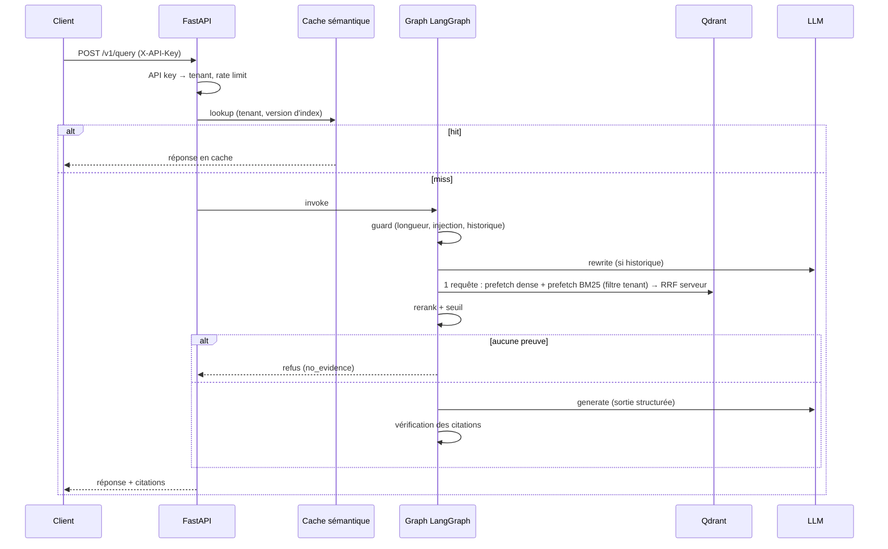

# Architecture

## Plan de données
- Collection physique `docs_vN`, alias `docs`. Payload : `chunk_id, text, parent_text, source, section, tenant, doc_hash`.
- Index payload sur `tenant` et `source` (obligatoires pour la perf filtrée).

## Pipeline d'ingestion
`upload → fichier (stockage objet) → queue → worker → load → chunk → (contexte LLM) → embed → upsert (replace par source)`.

## Pourquoi LangGraph ici
Pipeline linéaire avec 3 branches (blocked / no_evidence / ungrounded). Le graphe donne : spans nommés par nœud dans LangSmith, état typé, tests par nœud, et c'est la base réutilisée dans `agentic-rag` (où l'on ajoute des boucles).

## Décisions
[ADR 0001-0004](adr/) — stack, chunking, hybride, file d'ingestion.
